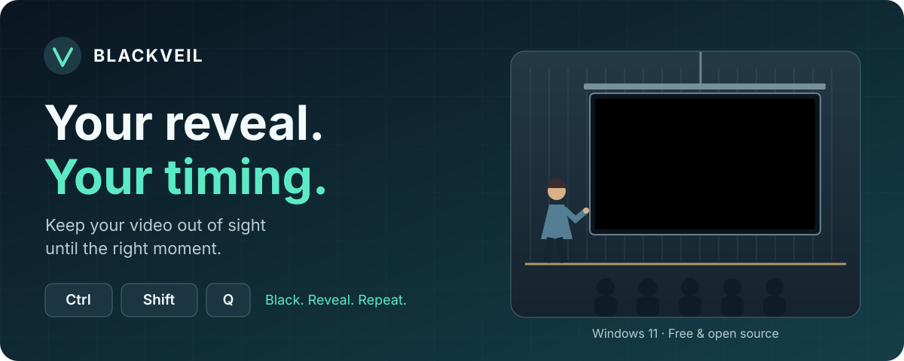

# Blackveil



[](https://github.com/747elias/Blackveil/actions/workflows/build.yml)
[](https://github.com/747elias/Blackveil/releases/latest)
[](LICENSE)

**Keep your video out of sight until the right moment.**

Blackveil covers **every connected display in black** with one global shortcut. Use it before and after a video in your presentation: your audience sees the content when you are ready, while the focus stays on your words in between. Ordinary keyboard and mouse input is intercepted while blackout is active.

**`Ctrl` + `Shift` + `Q` → black. Press it again → reveal.**

### [Download Blackveil for Windows 11](https://github.com/747elias/Blackveil/releases/latest)

[Portable EXE](https://github.com/747elias/Blackveil/releases/latest/download/Blackveil.exe) · [All releases](https://github.com/747elias/Blackveil/releases) · [Changelog](CHANGELOG.md) · [Manual test plan](docs/TESTPLAN.md)

## Built for the moment in your presentation

1. **Prepare.** Connect your projector, cue your video and pause it before your talk.
2. **Hide.** Press **Ctrl + Shift + Q**. Your projector and your other displays go black.
3. **Reveal.** When you reach the right point, press the shortcut again, then start your video.
4. **Continue.** When the clip ends, return to black and keep presenting.

Blackveil hides all connected displays, including your laptop. You cannot operate the desktop behind blackout. **You control playback separately:** Blackveil does not pause videos, mute audio, dim screens or power down a projector.

> Blackveil is a temporary visual and input shield, **not a Windows lock or a security boundary**. Protected Windows functions remain available. Use Windows locking for access protection.

## Small app. One clear job.

- **A shortcut that works across apps.** The default is Ctrl + Shift + Q, with key repeat prevention. Record your own combination or choose its keys in Settings.
- **Every display covered.** Borderless, topmost black windows, with support for different resolutions, per-monitor DPI and display changes.
- **Fewer accidental inputs.** Ordinary keyboard and mouse input is intercepted; overlays discard pointer, touch, pen and gesture messages.
- **Lives in the system tray.** No main window. Left-click the icon for Settings; right-click for blackout, startup, About and Quit.
- **Updates on your terms.** Check manually or schedule checks and installation independently. See what changed after updating.
- **Install your way.** Just for you, for all users, or portable. The tray app runs without administrator privileges. No separate .NET runtime is required.

## Install and get started

| Download | What it does |
| --- | --- |
| `Blackveil-Setup-<version>.exe` | Installs Blackveil, adds shortcuts and an uninstaller, and lets you choose the installation scope. |
| `Blackveil.exe` | Runs directly from a folder you choose. No installation wizard. |
| `Blackveil-<version>-win-x64.zip` | Contains the portable EXE, this README and the MIT license. |
| `SHA256SUMS.txt` | SHA256 checksums for the three downloads above. |

The current release targets **Windows 11 x64**. ARM64 devices may use Windows x64 emulation; there is no native ARM64 build.

In Setup, choose **Just you** (`%LOCALAPPDATA%\Programs\Blackveil`, no administrator privileges) or **All users** (`%ProgramFiles%\Blackveil`, normal Windows administrator approval). For a personal installation, **Start Blackveil with Windows** is available in Setup. For a system-wide installation, each user enables their own startup preference from the tray menu.

After starting Blackveil, find its icon in the system tray, including the hidden-icons area if necessary. Startup only launches the tray app; it never turns blackout on automatically. Only one instance runs per interactive Windows session.

**Unsigned download:** Blackveil is not code-signed. Windows SmartScreen may show a warning. Check the source and compare the downloaded file with the release checksum before running it:

```powershell
Get-FileHash .\Blackveil.exe -Algorithm SHA256
Get-Content .\SHA256SUMS.txt
```

### Choose your shortcut

Left-click the tray icon and select **Record shortcut**. Press your combination, then select **Save**. Alternatively, choose a key and tick Ctrl, Alt, Shift or Win. **Default** restores Ctrl + Shift + Q; closing without saving discards the draft.

Single keys, modifier keys on their own, Shift combinations, Windows keys, F12 and special keys can be selected. For a modifier alone, press and release it. Click the recording button again to cancel recording; Escape itself can be a shortcut. Blackout is paused while Settings is open.

Windows may reject or intercept reserved or already assigned shortcuts. Blackveil still saves your choice and explains the problem. If registration fails, blackout stays disabled and Settings remains accessible. Even successful registration cannot guarantee a protected system combination will work. The same saved shortcut activates and exits blackout; **release its main key when exiting** to prevent repeat activation.

Settings are in English on every supported Windows language. Regional date/time formats and keyboard layouts remain unchanged. Windows-owned prompts, such as UAC, follow Windows settings.

## Updates

Under **Settings → Updates**, automatic checks and automatic installation have separate switches. Select **Save update settings** to apply them; shortcut settings are saved separately.

| Setting | Choices |
| --- | --- |
| Check for updates | At startup, every six hours, daily at a local time, or every seven days |
| Install automatically | As soon as an update is found, at next startup, or daily at a local time |
| Manual check | **Check for updates now**, even with automatic checks disabled |

By default, Blackveil checks at startup and **asks before installing**. Enable automatic installation for updates without the app's confirmation question. A manual check then installs an available update immediately, regardless of the automatic installation schedule. System-wide installation still requires Windows administrator approval.

Schedules run only while Blackveil is running; startup can be enabled independently. Missed daily times while the app is closed move to the next scheduled occurrence. Checks, prompts and installation are deferred during blackout. Downloads run in the background, and the app restarts without enabling blackout. **What's new** shows changes since the last version you viewed.

Updates come from stable releases in this repository, without a token or GitHub account. The updater validates asset addresses and SHA256 checksums before execution; the helper verifies the payload again. Checksums detect corruption, but do not replace code signing or protect against a compromised release source.

Installed copies keep their scope with `/CURRENTUSER` or `/ALLUSERS`. Only the system-wide installer is elevated through normal UAC; the helper and restarted tray app remain under the original account. Portable updates replace the EXE in its existing folder. Portable and personal installation folders must be writable by the current user. The previous EXE is backed up for recoverable failures; a full transaction covering every installer registry entry is not guaranteed. A failed version is not automatically installed again in a loop; manual retry remains available. System installations may need repair using Setup if an interrupted update cannot complete.

Versions up to **2.0.1** do not include an updater. Install a newer version manually once to enable future updates.

## Startup, settings and uninstalling

The tray menu and personal installer share the `Blackveil` value in:

```text
HKCU\Software\Microsoft\Windows\CurrentVersion\Run
"<full path to Blackveil.exe>" --autostart
```

The installer reads the actual startup state; explicit `/TASKS=autostart` is respected. Keep a portable EXE at a stable path if startup is enabled. Disable its startup entry before deleting or moving it.

Personal data is stored in `%LOCALAPPDATA%\Blackveil`: `settings.json` for the shortcut; separate JSON files for update preferences, schedule state and results; `updates` for cached packages; and `logs` for operational errors. No keystrokes, screenshots or private content are logged. Logs older than 14 days and update cache folders older than seven days are removed during later app activity.

To uninstall, exit blackout with your shortcut, choose **Quit** in the tray menu, then use **Windows Settings → Apps → Installed apps → Blackveil**. A personal uninstall removes its settings, cache and logs. A system uninstall preserves user-profile data. The uninstaller removes the current account's startup entry only when it points at that installation; it does not alter other users' profiles or unrelated Run entries.

**Changing installation scope:** quit and uninstall the old copy before installing in the other scope. Automatic updates never change scope. For deployment, use `/CURRENTUSER` or `/ALLUSERS` explicitly. A silent system install does not create a personal startup entry for an administrator account used during elevation.

## Build locally

Use the **.NET 10 LTS SDK** and **Inno Setup 6** on Windows 11. Visual Studio is optional. SDK selection is in `global.json`; the application version is defined centrally in `Directory.Build.props`.

```powershell
git clone https://github.com/747elias/Blackveil.git
cd Blackveil
dotnet build Blackveil.sln -c Release -warnaserror
dotnet test tests/Blackveil.Core.Tests -c Release --no-build

# Real user32 hooks and injected input: use an unlocked, dedicated test session.
dotnet run --project tests/Blackveil.Windows.Tests -c Release --no-build

# Creates the portable EXE, ZIP, installer and SHA256SUMS.txt.
./scripts/Package.ps1
```

Native Windows tests must run on an unlocked interactive desktop, without another Blackveil instance. They fail when native registration or the input path fails; they are not silently skipped. Test scripts that install or update the app require a clean test profile and machine.

Packaging produces a self-contained, single-file `win-x64` EXE in `artifacts/release`. The .NET bundle may extract native runtime files into a temporary bundle directory at first launch. Build outputs are excluded from Git.

Linux can cross-build and publish the Windows target, and run the core tests. WinForms, native integration tests and the Inno Setup installer require Windows. See the [architecture](docs/ARCHITECTURE.md) and [manual test plan](docs/TESTPLAN.md) for implementation details and hardware coverage.

## GitHub Actions and releases

**Build and test** runs on pushes and pull requests using `windows-latest`. It treats warnings as errors, runs core and native Windows tests, and captures UI screenshots. **Release** repeats validation, packages the app, exercises installation, updates and uninstalling, then publishes the four downloads. A manual release-workflow run on a branch validates packaging without publishing. Notes come from the matching `CHANGELOG.md` section; an incomplete upload remains a draft.

To release a new version, update `Version` in `Directory.Build.props`, add its changelog section, then push a matching tag. For example, for a future `2.1.3` release:

```powershell
git add Directory.Build.props CHANGELOG.md
git commit -m "Release version 2.1.3"
git push origin main
git tag -a v2.1.3 -m "Blackveil 2.1.3"
git push origin v2.1.3
gh run list --workflow release.yml
gh release view v2.1.3 --json url,assets
```

The tag must match the central version. Actions use the short-lived `GITHUB_TOKEN`; authenticate local GitHub CLI work with `gh auth login`. Never commit credentials. Inspect failures with `gh run view <RUN-ID> --log-failed`. Fix source errors before a new release; an unchanged infrastructure failure can be retried with `gh run rerun <RUN-ID> --failed`.

## Technical limits

- **Protected Windows functions stay available.** Ctrl + Alt + Delete, UAC, the secure desktop, session locking and other protected functions are neither bypassed nor blocked. Desktop, session and power changes turn blackout off as a precaution; it can be activated again afterward.
- **Input interception has limits.** Low-level hooks suppress ordinary keyboard and mouse input on the current input desktop. Overlays also discard pointer, touch and gesture messages. OEM gestures, hardware keys, drivers, Raw Input consumers, protected surfaces and other topmost windows cannot be fully shielded by this app.
- **Elevated apps are subject to UIPI.** Interception and synthetic key/button releases may be restricted across integrity levels. Blackveil runs `asInvoker`, without UIAccess, drivers, `BlockInput`, security changes or persistent keyboard, mouse or touch changes. Release the shortcut modifiers after exiting blackout.
- **Cleanup is defensive, not a system guarantee.** Normal exit, partial activation and handled errors remove hooks, close overlays and restore the cursor. A hook-thread failure deactivates blackout; an active-only watchdog terminates a stuck UI after about ten seconds. After a hard process termination, Windows releases process-owned resources; .NET handlers cannot be guaranteed to run. Windows may silently remove a slow hook, and no supported handle query reliably detects that condition. A system or driver hang is beyond a user app's control.
- **Low idle activity.** There are no input-polling timers while inactive. Enabled update schedules use a timer for the next due event; with automation off, that timer is stopped.

The [manual test plan](docs/TESTPLAN.md) separates automated evidence from real hardware checks, especially touch, pen, mixed-DPI displays, standby, standard-user UAC and multiple Windows accounts.

## Why WinForms?

WinForms suits a small tray utility: `NotifyIcon`, ordinary HWNDs and direct Win32 message handling, with little idle work. WPF would add rendering and layout capabilities that black overlays do not need, while still requiring Win32 interop. WinUI 3 would add Windows App SDK and deployment complexity for a tray-only app. Per-Monitor-V2 is enabled before the first window is created.

Built with C# and .NET 10 LTS. [MIT licensed](LICENSE).
